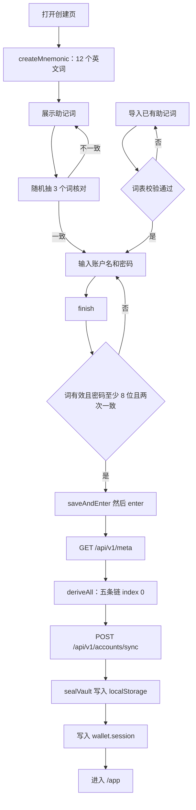
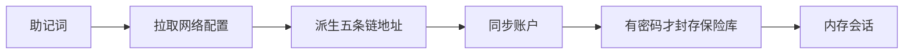
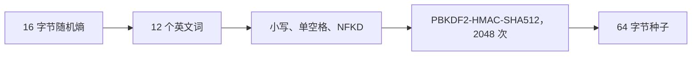
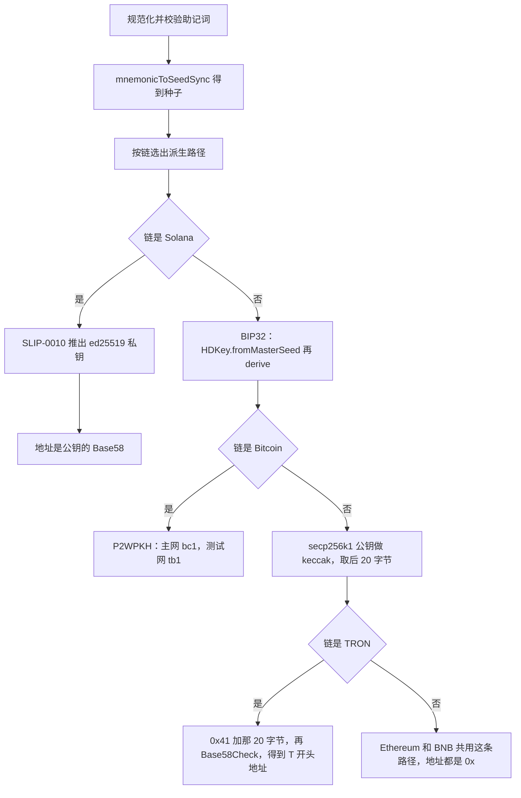

# 创建钱包流程

从 `Setup.vue` 的 `finish` 进入 `session.ts` 的 `saveAndEnter`，再到 `enter`。明文助记词只留在当次内存里。服务器只收到账户名和五条链的地址，收不到助记词和私钥。

## 总流程



导入已有助记词不生成新词，校验通过后同样进入密码页。解锁已有保险库走 `unlock`，会调用 `enter`，但不会再次 `sealVault`。

## 页面上的四步

1. 没有助记词时，`Setup.vue` 用 `createMnemonic()` 生成 12 个词。它调用 `@scure/bip39` 的 `generateMnemonic(wordlist, 128)`。
2. 核对时抽出 3 个位置，必须和展示过的词一致，否则回到展示页。
3. 核对通过，或导入的助记词通过 `mnemonicValid`，进入密码页。
4. `finish` 再检查一遍：助记词在 BIP-39 英文词表里，密码至少 8 位，两次输入相同。账户名空着时用「主账户」。然后调用：

```ts
await saveAndEnter(normalizeMnemonic(mnemonic.value), password.value, label.value.trim() || "主账户");
await router.push("/app");
```

`saveAndEnter` 只是把参数交给 `enter`。

## enter 做的四件事



对应代码在 `web-vue/src/session.ts`：

```ts
const meta = await api<Meta>("/api/v1/meta");
const derived = deriveAll(mnemonic, meta.network);
const account = await api<Account>("/api/v1/accounts/sync", {
  method: "POST",
  body: JSON.stringify({
    label,
    addresses: Object.values(derived).map((item) => ({
      chain: item.chain,
      address: item.address,
      path: item.path,
    })),
  }),
});
if (password) await sealVault(password, mnemonic, label);
wallet.session = { label: account.label, mnemonic, accountId: account.id, meta, derived };
```

同步请求里只有 `chain`、`address`、`path`。私钥不出浏览器。

## 种子生成规则

五条链共用这一颗 64 字节种子。`deriveAddress` 先把助记词收成小写、单词之间只留一个空格，再交给 `@scure/bip39` 的 `mnemonicToSeedSync`。调用时没有传第二个参数，BIP-39 口令是空字符串。页面上那个至少 8 位的密码不参与种子，只用来做后面的 `sealVault`。



助记词本身按 BIP-39 从熵变来：

1. `createMnemonic()` 使用强度 128，也就是 `randomBytes(16)`，得到 16 字节熵。
2. 校验位取 `SHA-256(熵)` 的高 4 位。128 位熵加 4 位校验，共 132 位。
3. 每 11 位对应英文词表里的一个下标。词表有 2048 个词，所以是 12 个词。
4. `validateMnemonic` 会把词译回熵，并核对这 4 位校验。词数必须是 12、15、18、21 或 24，且每个词都在英文词表里。

种子的计算在 `mnemonicToSeedSync` 里：

```text
盐 = NFKD("mnemonic" + 口令) = "mnemonic"
种子 = PBKDF2-HMAC-SHA512(NFKD(助记词), 盐, 迭代 2048 次, 输出 64 字节)
```

同一套词、空口令，种子永远相同。这颗种子不能反推回助记词。后面的 Bitcoin、Ethereum、BNB、Solana、TRON 都从它往下派生。

## 同一套助记词怎么变成五个地址

`deriveAll` 用同一个助记词、同一个 `meta.network`，对五条链各派生一次，序号都是 `0`。



| 链 | 路径 | 地址 |
|---|---|---|
| Bitcoin 主网 | `m/84'/0'/0'/0/0` | `bc1...` |
| Bitcoin 测试网 | `m/84'/1'/0'/0/0` | `tb1...` |
| Ethereum | `m/44'/60'/0'/0/0` | `0x...` |
| BNB | `m/44'/60'/0'/0/0` | 与 Ethereum 同一把私钥、同一个 `0x` 地址 |
| Solana | `m/44'/501'/0'/0'` | Base58 公钥 |
| TRON | `m/44'/195'/0'/0/0` | `T...`。曲线仍是 secp256k1，路径和 ETH 不同，私钥不同 |

## 当时拉到的网络配置

`GET /api/v1/meta` 这一次返回的是 live + testnet：

```json
{
  "mode": "live",
  "network": "testnet",
  "chains": ["bitcoin", "ethereum", "bnb", "solana", "tron"],
  "warnings": ["当前是 live + testnet。节点是公共 RPC，失败时看错误里的 hint。"],
  "settlement": {
    "name": "CardSettlement",
    "note": "本地链上，用户签名存入和提现，运营方账户结算卡消费。卡账本仍按分记账。"
  }
}
```

每条链还有本币、小数位和浏览器地址。Ethereum、BNB、Solana、TRON 上的 USDT、USDC 在这份配置里没有官方合约，余额按 0 处理。完整资产列表仍在 `思路整理.md`。

## 保险库

`sealVault` 不保存密码明文。随机 16 字节盐和 12 字节 IV，用 PBKDF2-SHA256 迭代 21 万次推出 256 位 AES-GCM 密钥，加密 `{ mnemonic, label }` 后写入 `localStorage` 的 `aegis.vault.v1`。
