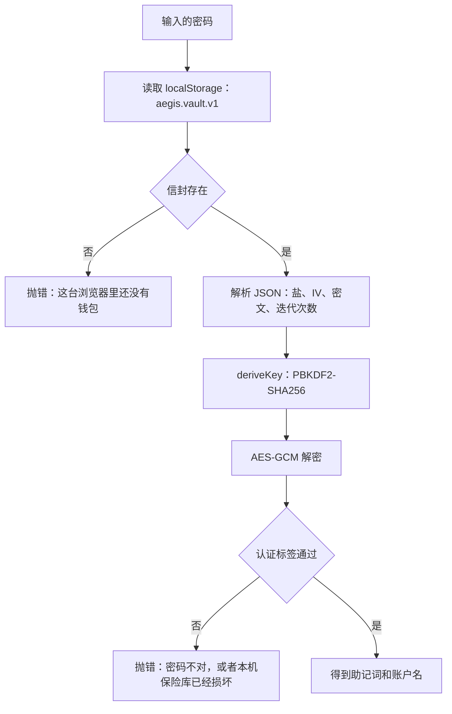
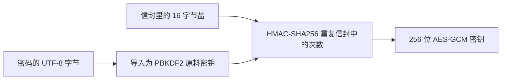

# 解锁流程

欢迎页输入密码后，`Welcome.vue` 的 `enter` 调用 `unlock`。`unlock` 先用 `openVault` 解开助记词，再走 `enter`。这次没有密码参数，所以不会再次 `sealVault`。

## openVault

密钥不是从保险库里读出来的。`deriveKey` 用这次输入的密码，配上信封里保存的盐和迭代次数，重新算一把 256 位 AES-GCM 密钥：

解密使用信封里的 12 字节 IV 和密文。密文末尾的认证标签同时检查密码和数据。密码错、密文被改过，都会在这一步失败，函数不区分这两种原因。

通过之后，明文是 UTF-8 的 `{ mnemonic, label }`。`unlock` 把这两个值交给 `enter`：拉取 `/api/v1/meta`、派生五条链地址、同步账户，然后写入 `wallet.session`。
