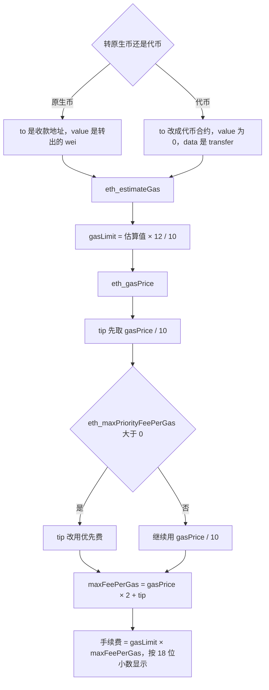
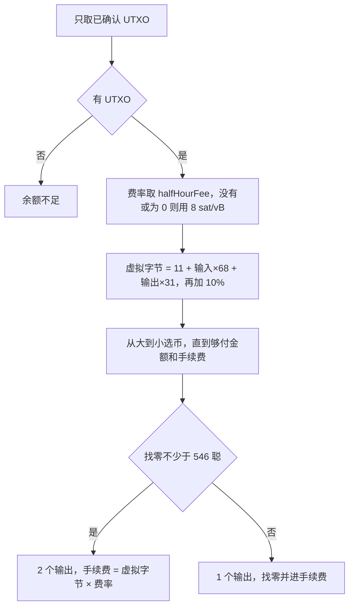
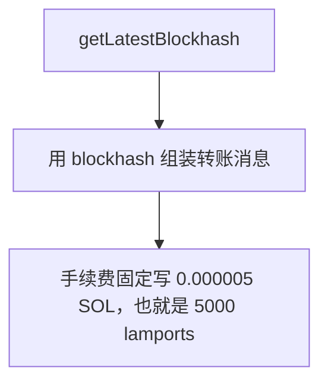
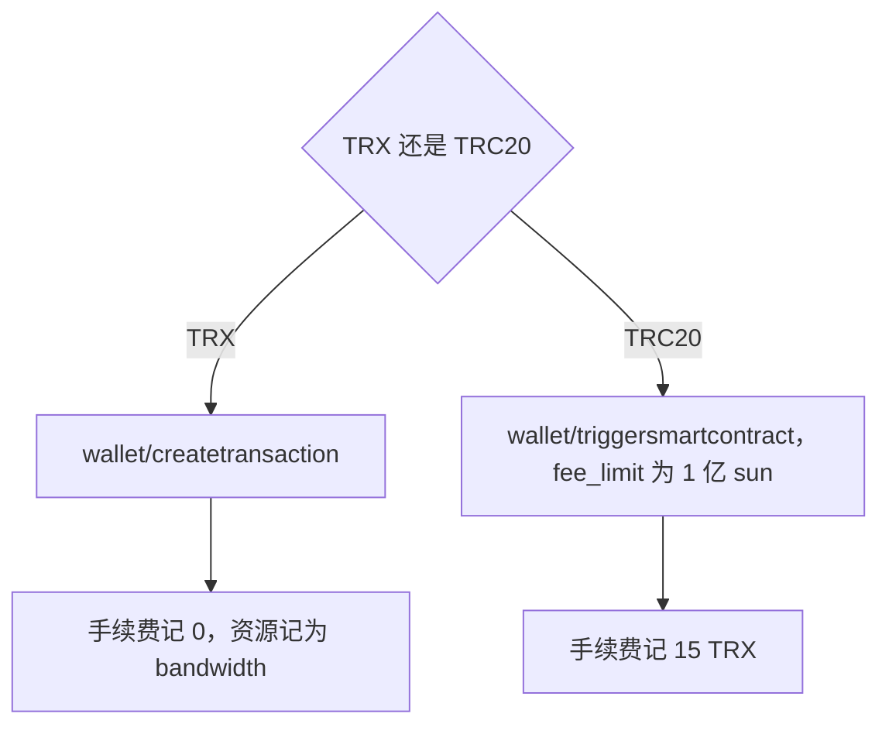

# 转账菜单：获取报价

点「获取报价」只向服务器要一笔未签名交易和手续费。请求里没有私钥。这一步不签名、不广播、不写入转账记录。

## 前后端

```mermaid
flowchart TD
  form[转账页填写链、资产、收款地址、金额] --> click[提交：Send.vue prepare]
  click --> post["POST /api/v1/transfers/prepare"]
  post --> ctrl[TransferController]
  ctrl --> svc[TransferService.prepare]
  svc --> ready[校验账户、地址、资产和金额]
  ready --> mode{aegis.mode}
  mode -->|sandbox| box[沙箱适配器本地拼一笔教学交易]
  mode -->|live| node[按链询问对应节点]
  box --> usd[有价格则把手续费折成美元]
  node --> usd
  usd --> page[页面展示手续费和 warnings]
```

前端 `from` 不是用户手填的，而是当前会话里这条链已经派生好的地址。改链、改资产、改收款地址或改金额都会清掉上一次报价。

请求体：

```json
{
  "accountId": "当前账户编号",
  "chain": "ethereum",
  "asset": "ETH",
  "from": "该链派生地址",
  "to": "收款地址",
  "amount": "人类可读金额"
}
```

## 服务端先校验

`TransferService.ready` 在问节点之前做完这些检查，不过就直接返回错误：

1. 链必须是 bitcoin、ethereum、bnb、solana、tron 之一。
2. `from` 必须属于这个 `accountId` 已同步的地址。
3. `to` 必须符合该链、该网络的地址格式。
4. 资产必须在当前网络的配置里，金额小数位不能超过该资产精度，且换算后大于 0。

通过后把金额换成最小单位，再交给这条链的适配器。

## live：每条链怎么算手续费

`aegis.mode` 不是 `sandbox` 时，五条链各问自己的节点。返回形状都是 `PrepareResult`。手续费符号是这条链的原生币。测试网节点来自 `application.properties` 里的 `aegis.adapter.testnet.*`。

| 链 | 手续费标准 | 报价时调用的接口 |
|---|---|---|
| Ethereum | `gasLimit`（燃气上限）= `eth_estimateGas`（估算燃气）× 1.2。`tip`（优先费）用 `eth_maxPriorityFeePerGas`（每单位燃气的最高优先费），没有或为 0 就用 `eth_gasPrice`（燃气单价）/ 10。`maxFeePerGas`（每单位燃气的最高费用）= `eth_gasPrice` × 2 + `tip`。手续费 = `gasLimit` × `maxFeePerGas`，18 位小数，单位 ETH。转代币时 gas 仍用 ETH 付 | `POST https://ethereum-sepolia.publicnode.com`：`eth_estimateGas`、`eth_gasPrice`、`eth_maxPriorityFeePerGas` |
| BNB | 与 Ethereum 同一套公式，单位是 BNB | `POST https://bsc-testnet.publicnode.com`：同样三个接口 |
| Bitcoin | 费率取 `halfHourFee`（半小时确认费率），没有或为 0 则用 8 `sat/vB`（每虚拟字节多少聪）。虚拟字节 = `(11 + 输入×68 + 输出×31)` 再加 10%。有找零且找零不少于 546 聪时，手续费 = 虚拟字节 × 费率；否则找零并进手续费。只花已确认的 `UTXO`（未花费输出） | `GET https://mempool.space/testnet/api/v1/fees/recommended`；`GET https://mempool.space/testnet/api/address/{地址}/utxo` |
| Solana | 固定 **5000 lamport**（索拉纳最小单位），也就是 **0.000005 SOL**。这个数不向节点询价 | `POST https://api.devnet.solana.com`：`getLatestBlockhash`（取最新区块哈希）。只为组装交易，不参与手续费数字 |
| TRON 原生 TRX | 手续费记 **0**。优先扣 `bandwidth`（带宽），带宽不够才燃烧 TRX。这个 0 不是节点算出的燃烧额 | `POST https://api.shasta.trongrid.io/wallet/createtransaction`（创建交易） |
| TRON 上的 TRC20 | 手续费记 **15 TRX**。`fee_limit`（费用上限）是 1 亿 `sun`（波场最小单位），这是燃烧上限，不是精确报价 | `POST https://api.shasta.trongrid.io/wallet/triggersmartcontract`（触发智能合约） |

英文名和中文对照：

| 英文 | 中文 |
|---|---|
| gasLimit | 燃气上限。这一笔最多允许烧掉多少燃气 |
| eth_estimateGas | 估算燃气。节点按这笔交易试算会花多少 |
| eth_gasPrice | 燃气单价 |
| eth_maxPriorityFeePerGas | 每单位燃气的最高优先费，也就是小费上限 |
| maxFeePerGas | 每单位燃气的最高总费用 |
| tip | 优先费 |
| wei | 以太坊最小单位，1 ETH = 10^18 wei |
| gwei | 10 亿 wei |
| halfHourFee | 半小时确认费率 |
| sat/vB | 每虚拟字节多少聪。聪是比特币最小单位 |
| UTXO | 未花费输出。还没被花掉的那一笔比特币 |
| lamport | 索拉纳最小单位，1 SOL = 10^9 lamport |
| getLatestBlockhash | 取最新区块哈希 |
| fee_limit | 费用上限 |
| sun | 波场最小单位，1 TRX = 10^6 sun |
| bandwidth | 带宽 |

### Ethereum 和 BNB

两条链共用 `EvmClient.quote`。手续费分别记成 ETH 和 BNB。



代币没有配置合约地址时，直接返回「当前网络不能转这个代币」，不会去估算 gas。`gasLimit` 超过 200 万时，报价里会多一条警告。

### Bitcoin

只接受 BTC。稳定币在这条路径上会直接拒绝。



有找零时先按 2 个输出算。找零低于 546 聪就不再单列找零，手续费改成「选中的输入总额减去转出金额」。

### Solana

报价只覆盖 SOL。USDT 和 USDC 可以查余额，这条转账路径会拒绝。



这 5000 lamports 不是节点报出来的。节点只提供大约一分钟内有效的 blockhash。转到新地址时，金额通常还要另加约 0.00089 SOL 租金，这个数不进 `fee.amount`。

### TRON



TRX 优先扣带宽，带宽不够才会燃烧 TRX，报价里的 0 不是节点算出的燃烧额。15 TRX 是估算，也不是节点当场给出的精确值。能量不够时按 `fee_limit` 燃烧，上限是 1 亿 sun。

## sandbox：不访问节点

`aegis.mode=sandbox` 时五条链都走沙箱适配器。EVM 的 `chainId` 固定为 `84532026`，nonce 固定为 0。原生转账按 21000 gas、代币按 65000 gas，`maxFeePerGas` 固定 20 gwei。签出来的交易不能在主网或测试网重放。

## 回到页面

响应里的 `fee.amount` 和 `fee.symbol` 显示为手续费。有美元价格时带上 `fee.usd`。`warnings` 逐条显示。此时还没有签名按钮之外的链上交易；「只签名」和「签名并广播」是报价之后的另一步，请求的是 `POST /api/v1/transfers`。
