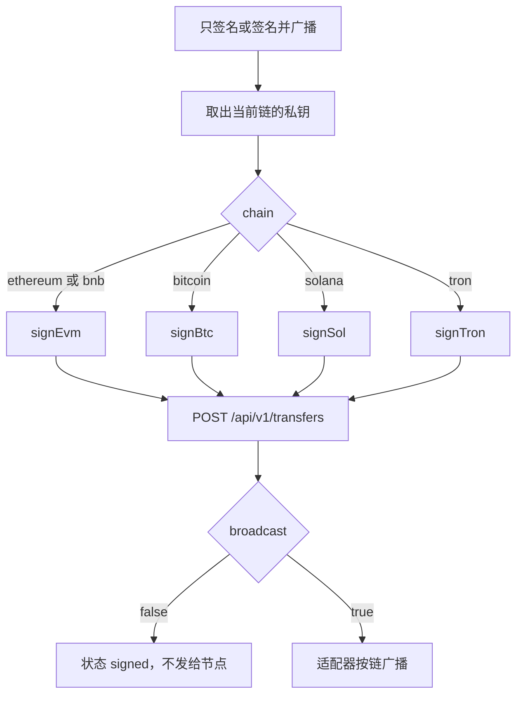

# 转账菜单：签名逻辑

点「只签名」或「签名并广播」时，浏览器用当前这条链的私钥给报价签名。私钥来自解锁后留在内存里的派生结果，不会出现在请求里。Vue 和 React 的 `sign.ts` 是同一套实现。

结算页的 approve、deposit、withdraw 不走这里。那三笔由 MetaMask 用 `eth_sendTransaction` 发给本机 Hardhat。

## 页面怎么进入签名

报价成功后，`prepared.payload` 里已经是未签名内容。`Send.vue` 的 `sign` 只做两件事：本地签名，再把结果交给服务器。



请求体里和签名有关的字段是 `signedPayload` 和 `broadcast`。`from` 仍是会话里的派生地址，不是用户手填的。

五条链的私钥都是 32 字节，但曲线和路径不同：

| 链 | 路径 | 曲线 | 地址从哪来 |
|---|---|---|---|
| Ethereum、BNB | `m/44'/60'/0'/0/0` | secp256k1 | 未压缩公钥去掉 `04` 后做 Keccak-256，取后 20 字节，再做 EIP-55 |
| Bitcoin 主网 | `m/84'/0'/0'/0/0` | secp256k1 | 压缩公钥的 HASH160，bech32，前缀 `bc` |
| Bitcoin 测试网 | `m/84'/1'/0'/0/0` | secp256k1 | 同上，前缀 `tb` |
| Solana | `m/44'/501'/0'/0'` | ed25519 | 公钥本身，Base58 |
| TRON | `m/44'/195'/0'/0/0` | secp256k1 | `0x41` 加上以太坊那 20 字节，再 Base58Check |

Ethereum 和 BNB 是同一把私钥、同一个 `0x` 地址。签名函数也是同一个。把它们分开的是报价里的 `chainId`。

界面密码只用来解开保险库，不参与签名。BIP-39 口令是空字符串，种子盐是 `mnemonic`。

## Ethereum 和 BNB

`signEvm` 签的是一笔 type 2 交易，也就是 EIP-1559。`ethers` 的 `Wallet.signTransaction` 完成哈希和 secp256k1 签名。

报价交给它的字段：

| 字段 | 含义 |
|---|---|
| chainId | 写进被签的字节，防止拿到另一条链重放 |
| nonce | 这个地址的下一笔序号 |
| to | 原生转账是收款人；代币转账是代币合约 |
| value | 原生转账是 wei；代币转账是 `0` |
| data | 原生转账是 `0x`；代币是 `transfer` 的 calldata |
| gasLimit | 燃气上限 |
| maxFeePerGas | 每单位燃气的最高总费用 |
| maxPriorityFeePerGas | 每单位燃气的最高优先费 |

代币的 calldata 是 4 字节选择器 `a9059cbb`，再加两个 32 字节槽：收款地址左补零到 32 字节，金额按大端右对齐。

被签的原文是：

```text
0x02 || RLP([
  chainId,
  nonce,
  maxPriorityFeePerGas,
  maxFeePerGas,
  gasLimit,
  to,
  value,
  data,
  accessList
])
```

代码没有传 `accessList`，序列化时是空列表。摘要是这段字节的 Keccak-256，32 字节。secp256k1 对这 32 字节签名，得到 `r`、`s` 和 `yParity`。`s` 取曲线阶的低半段。

签完后的广播字节是：

```text
0x02 || RLP([上面 9 项, yParity, r, s])
```

`yParity` 是 0 或 1。这里不用波场那种 `27 + recovery`。返回值是带 `0x` 的十六进制字符串。

`broadcast` 为 true 时，服务器把整段十六进制交给 `eth_sendRawTransaction`。交易哈希是这段已签名字节的 Keccak-256，由节点返回。

沙箱的 `chainId` 固定是 `84532026`，nonce 固定是 0。签名算法和真网一样，但这笔交易不能在 Sepolia 或 BSC 上重放。真网的 `chainId` 来自节点：Sepolia 是 11155111，BSC 测试网是 97，BSC 主网是 56。

## Bitcoin

`signBtc` 签的是原生隔离见证 P2WPKH。库是 `@scure/btc-signer`。报价只给输入和输出，脚本由私钥当场算出来。

每个输入带三样东西：上一笔交易的 `txid`、输出下标 `vout`、这笔输出的金额 `value`（聪）。`witnessUtxo.script` 是当前压缩公钥对应的 P2WPKH 锁定脚本：`OP_0` 再压入 20 字节的 HASH160。金额必须和被花掉的那笔输出一致，因为隔离见证的签名摘要里含有这个金额。

输出按报价逐条写入。收款人是一条，找零够 546 聪时再写一条回到自己。找零不是单独签名，它和收款一起进输出摘要。

交易默认版本是 2，锁定时间是 0，每个输入的 sequence 是 `0xffffffff`。签名类型是 `SIGHASH_ALL`，数值 1。意思是所有输入和所有输出都锁进签名，改任何一条都会让签名失效。

每一个输入单独算一次 BIP143 摘要，再做两次 SHA-256。摘要按这个顺序拼接，整数都是小端：

```text
version                         4 字节
hashPrevouts                    32 字节，全部输入的 txid 和 vout
hashSequence                    32 字节，全部输入的 sequence
本输入的 txid                   32 字节
本输入的 vout                   4 字节
scriptCode                      P2PKH 脚本：OP_DUP OP_HASH160 <公钥哈希> OP_EQUALVERIFY OP_CHECKSIG
本输入的金额                    8 字节
本输入的 sequence               4 字节
hashOutputs                     32 字节，全部输出的金额和锁定脚本
locktime                        4 字节
sighash type                    4 字节，这里是 1
```

P2WPKH 的锁定脚本本身不进 `scriptCode`。库先把它换成上面这条等价的 P2PKH 脚本，这是 BIP143 对隔离见证 v0 的规定。

secp256k1 对这个 32 字节摘要签名。曲线默认把 `s` 压到低半段，再编成 DER。DER 后面再拼一个字节 `0x01`，标明 `SIGHASH_ALL`。

`finalize` 之后，这个输入的 scriptSig 是空的。见证栈是两项：

```text
[ DER签名 || 0x01 , 33 字节压缩公钥 ]
```

多个输入就重复上面的摘要和签名。`extract` 得到可广播的原始交易，返回不带 `0x` 的十六进制。

广播时服务器 `POST {mempool}/tx`，正文就是这段十六进制。节点返回的 64 位十六进制是这笔交易的 txid。txid 是不含见证的交易体做两次 SHA-256，再把字节序反过来；这个哈希由节点计算，浏览器不单独算。

沙箱的 UTXO 是假的，签名结构仍是真的 P2WPKH。比特币网络不会接受那笔假输入。

## Solana

`signSol` 不自己组交易。服务端已经把要签的消息编成字节，再用 Base64 放进 `payload.message`。浏览器只对这段字节做 ed25519 签名。

原生 SOL 的消息由 `buildSolTransfer` 拼出来：

| 顺序 | 字节 | 含义 |
|---|---|---|
| 3 | `01 00 01` | 1 个签名者，0 个只读签名者，1 个只读未签名账户 |
| 1 | `03` | 账户个数 |
| 32 | 付款公钥 | 唯一需要签名的账户 |
| 32 | 收款公钥 | 可写，不签名 |
| 32 | 全 0 | 系统程序 |
| 32 | blockhash | 最近区块哈希，大约 1 分钟内有效 |
| 1 | `01` | 1 条指令 |
| 1 | `02` | 程序是账户列表里的第 3 个，也就是系统程序 |
| 1 | `02` | 这条指令用 2 个账户 |
| 2 | `00 01` | 付款人、收款人 |
| 1 | `0c` | 数据 12 字节 |
| 4 | 小端 `2` | 系统程序的 Transfer |
| 8 | 小端 lamports | 转出数量 |

USDT 和 USDC 走 `Spl.buildTokenTransfer`，消息头仍是 1 个签名者。不需要创建对方关联账户时，后面是 1 条 TransferChecked：指令号 `12`，接着小端金额和 1 字节目的精度。对方还没有这个币的关联账户时，前面再加 1 条 CreateIdempotent，指令数据是单字节 `1`。签名函数不区分这两种消息。

ed25519 用的是 32 字节种子，不是 secp256k1 那种先哈希再签名。`@noble/curves` 按 RFC 8032 做：

1. `SHA-512(种子)`。前 32 字节夹紧后是标量 `a`，后 32 字节是前缀。公钥 `A = a·B`。
2. `r = SHA-512(前缀 || 消息) mod L`，`R = r·B`。
3. `k = SHA-512(R || A || 消息) mod L`。
4. `S = (r + k·a) mod L`。
5. 签名是 `R || S`，一共 64 字节。

这里没有先对消息做 SHA-256 或 Keccak。消息原文直接进上面的 SHA-512。

可广播的交易是：

```text
0x01 || 64 字节签名 || 原来的消息
```

开头的 `0x01` 是 compact-u16 的签名个数。教学交易只有 1 个签名者，个数小于 128，所以占 1 个字节。整段再编成 Base64 返回。

广播调用 `sendTransaction`，编码声明为 base64。过期的 blockhash 会让节点拒绝，需要重新报价再签。沙箱的 blockhash 是 32 个字节 `0x07`，签名是真的，节点不会接受。

## TRON

`signTron` 签的是报价里的 `txID`，不是整段 JSON。

真网上这个 `txID` 由节点给出：对交易 `raw_data` 的 protobuf 字节做一次 SHA-256，再写成十六进制。原生 TRX 来自 `/wallet/createtransaction`，TRC20 来自 `/wallet/triggersmartcontract` 返回的 `transaction`。浏览器不再哈希一次。

步骤：

1. 把 `txID` 从十六进制解成 32 字节。
2. `secp256k1.sign(这 32 字节, 私钥, { lowS: true })`。`lowS` 把 `s` 压到曲线阶的低半段。随机数按 RFC 6979 从私钥和摘要推出，同一笔 `txID` 会得到同一个签名。
3. `toCompactRawBytes()` 是 64 字节，前 32 是 `r`，后 32 是 `s`。
4. 第 65 字节是 `27 + recovery`。`recovery` 是 0 或 1，所以这一字节是 27 或 28。节点靠它从签名恢复公钥。
5. 65 字节写成不带 `0x` 的十六进制。

返回值是 JSON 字符串：原样保留节点给的交易，只多一个字段：

```json
{
  "txID": "节点给的交易号",
  "raw_data": {},
  "raw_data_hex": "节点给的原文",
  "signature": ["65字节签名的十六进制"]
}
```

`signature` 是数组，因为一笔交易可以有多个签名。这里只有付款人一个。

广播时服务器把这份 JSON 交给 `/wallet/broadcasttransaction`。节点用 `txID` 和 `signature` 恢复地址，再和 `raw_data` 里的 `owner_address` 对比。`raw_data` 被改过，而 `txID` 没变，验签会失败。

付款地址从未收过 TRX 时，节点在报价阶段就返回 `no OwnerAccount`，到不了签名。

沙箱的 `txID` 是若干字段拼起来之后的 SHA-256，`raw_data_hex` 也不是节点的 protobuf。签名步骤相同，Shasta 不会接受。

## 五条链对照

| 链 | 签的原文 | 哈希 | 曲线 | 签名放哪 | 返回给服务器的样子 |
|---|---|---|---|---|---|
| Ethereum、BNB | EIP-1559 的 RLP，类型字节 `0x02` | Keccak-256 | secp256k1 | RLP 末尾的 `yParity, r, s` | `0x02` 开头的十六进制 |
| Bitcoin | 每个输入一份 BIP143 原文 | 两次 SHA-256 | secp256k1 | 见证栈里的 DER 加 `0x01`，再加压缩公钥 | 不带 `0x` 的原始交易 |
| Solana | 服务端编好的消息 | Ed25519 内部的 SHA-512 | ed25519 | 消息前面的 64 字节 | Base64，第一字节是 `0x01` |
| TRON | 节点给的 `txID` | 节点已经做过一次 SHA-256 | secp256k1 | JSON 的 `signature[0]`，65 字节，末字节是 `27` 或 `28` | 带 `signature` 的交易 JSON |

`broadcast` 为 false 时，服务器只把 `signedPayload` 存成 `signed`，不调用上面的广播接口。任何人拿到这段已签名字节都可以代为广播，所以「只签名」并没有把交易锁在本机。
